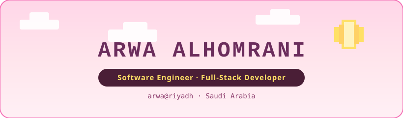
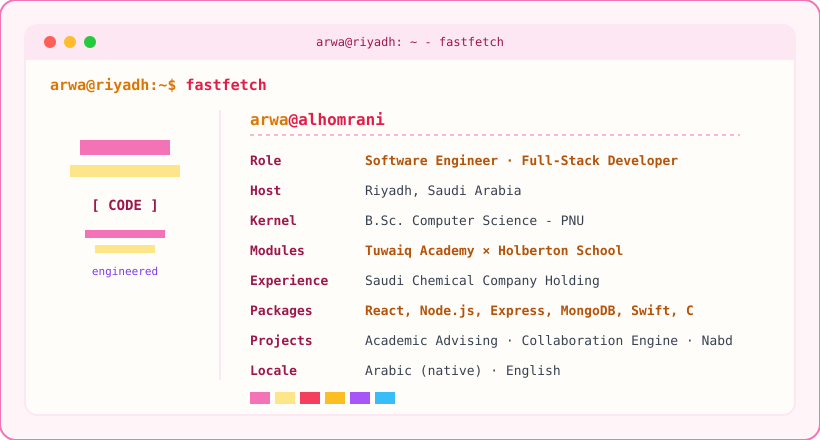
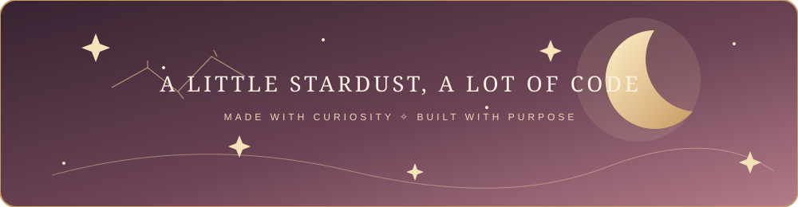

  

  

<h3 align="center">✦ WHAT I'M BUILDING ✦</h3>

<table align="center">
<tr>
<td width="33%" valign="top" align="center">
    
  **Academic Advising Platform** 
  Role-based access, structured academic workflows and automated advising logic.
</td>
<td width="33%" valign="top" align="center">
    
  **Real-Time Collaboration Engine** 
  Full-stack collaboration with Socket.io, real-time messaging and dynamic interactions.
</td>
<td width="33%" valign="top" align="center">
    
  **Nabd Healthcare App** 
  A SwiftUI iOS concept exploring real-time tracking of vital health metrics.
</td>
</tr>
</table>

<h3 align="center">✦ ARWA'S SKILL CONSTELLATION ✦</h3>

  

Each skill is a star. Every connection is another step in my software engineering journey.

<h3 align="center">✦ MY TOOLKIT ✦</h3>

  

<h3 align="center">✦ MY GOLDEN STAR TRAIL ✦</h3>

  

  

  
  
  

  ✧ building with intention, learning with curiosity, and leaving a little stardust in every commit ✧

  
✦ a little note

  
This space is a work in progress — just like every good engineer. Thanks for stopping by.

